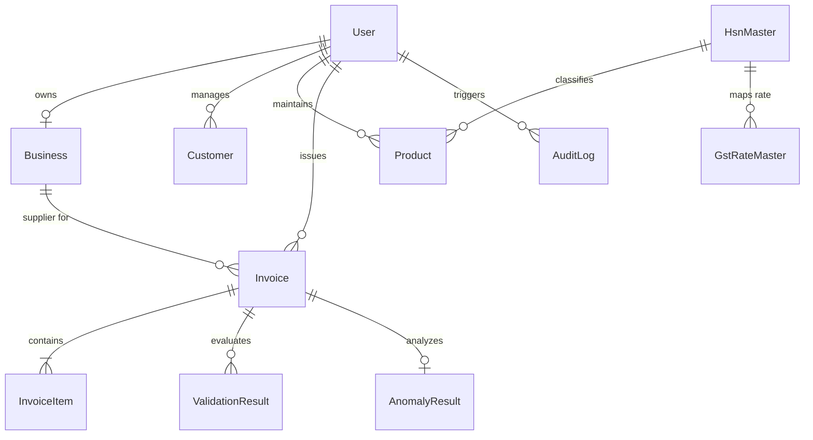

# GST SAHAYAK — Database Architecture & Data Dictionary

**Project:** GST Sahayak – A Hybrid Rule-Based and Explainable-AI System for GST Invoice Pre-Validation and Anomaly Detection  
**ORM:** Prisma Client v6.4.1  
**Database Engine:** SQLite (`server/prisma/dev.db`) (Development/Demo) / PostgreSQL (Production)  

---

## 1. Entity-Relationship (ER) Diagram

---

## 2. Table Schemas & Data Dictionary

### 2.1 `User`
Primary entity representing a business account owner or system administrator.
- `id` (String, PK, cuid): Unique user identifier.
- `email` (String, Unique): User email address used for authentication.
- `password` (String): Salted bcrypt hash of user password. Plaintext is never stored.
- `name` (String): Full name of the user.
- `role` (String, Default: "business_user"): Access tier (`business_user` or `admin`).
- `createdAt` / `updatedAt` (DateTime): Timestamps.

---

### 2.2 `Business`
Entity holding statutory organization profile and place of business.
- `id` (String, PK, cuid): Unique business identifier.
- `userId` (String, FK, Unique): Foreign key referencing `User.id` (1-to-1 relationship with cascade delete).
- `businessName` (String): Registered legal trade name.
- `gstin` (String): 15-character statutory GST identification number.
- `businessCategory` (String): Industry sector.
- `registrationType` (String, Default: "Regular"): Regular, Composition, or SEZ.
- `state` (String): Registered principal place of business state (e.g., "Maharashtra").
- `address` (String): Full postal address.
- `email` / `phone` (String): Official contact details.

---

### 2.3 `Customer`
Customer directory storing recipient billing details and place of supply.
- `id` (String, PK, cuid): Unique customer record ID.
- `userId` (String, FK): Tenant scoping key referencing `User.id`.
- `name` (String): Registered business or individual customer name.
- `gstin` (String, Nullable): Recipient 15-character GSTIN. Null for unregistered B2C consumers.
- `state` (String): Place of supply state (crucial for CGST/SGST vs IGST bifurcation).
- `address` / `email` / `phone` (String, Nullable): Optional communication details.

---

### 2.4 `Product`
Master catalog of goods and services sold by the business.
- `id` (String, PK, cuid): Unique product identifier.
- `userId` (String, FK): Tenant scoping key referencing `User.id`.
- `name` (String): Commercial product title or service description.
- `category` (String): General classification bucket (e.g., "Electronics & IT Hardware").
- `hsnSac` (String): 4, 6, or 8-digit HSN or 6-digit SAC code.
- `gstRate` (Float): Prescribed tax slab percentage (e.g. 18.0).
- `price` (Float): Base catalog selling price per unit.
- `unit` (String, Default: "PCS"): Unit of measurement (PCS, KGS, SET, MTH, HRS, SRV).
- `isVerified` (Boolean, Default: false): Indicates whether classification was reviewed and verified.

---

### 2.5 `Invoice`
Central transaction header recording financial figures, tax bifurcation, and risk assessments.
- `id` (String, PK, cuid): Unique invoice ID.
- `userId` (String, FK): Tenant scoping key referencing `User.id`.
- `businessId` (String, FK, Nullable): Reference to issuing `Business.id`.
- `invoiceNumber` (String): Consecutive serial number unique per tenant financial year.
- `invoiceDate` (DateTime): Date of supply issuance.
- `customerName` (String): Recipient name snapshot.
- `customerGstin` (String, Nullable): Recipient GSTIN snapshot.
- `customerState` (String): Place of supply state snapshot.
- `subtotal` (Float): Total before line item discounts.
- `discount` (Float): Total discount subtracted across all line items.
- `taxableAmount` (Float): Net assessable commercial tax base.
- `cgst` (Float): Central GST assessed (50% of intra-state tax).
- `sgst` (Float): State GST assessed (50% of intra-state tax).
- `igst` (Float): Integrated GST assessed (100% of inter-state tax).
- `totalGst` (Float): Sum of CGST, SGST, and IGST.
- `grandTotal` (Float): Final payable amount (`taxableAmount + totalGst`).
- `status` (String, Default: "DRAFT"): `DRAFT`, `VALIDATED`, `FINALIZED`, `CANCELLED`.
- `riskLevel` (String, Default: "VALID"): `VALID`, `WARNING`, `POTENTIAL_RISK`.
- `riskScore` (Float): 0 to 100% normalized hybrid risk score.
- `isInterState` (Boolean): Geographic flag indicating whether place of supply is outside supplier state.

---

### 2.6 `InvoiceItem`
Line items attached to an invoice.
- `id` (String, PK, cuid): Unique line item ID.
- `invoiceId` (String, FK): Parent invoice ID (cascade delete on invoice removal).
- `productId` (String, Nullable): Reference to catalog product.
- `productName` (String): Item title snapshot.
- `hsnSac` (String): Applicable classification code.
- `quantity` (Float): Number of units billed.
- `unitPrice` (Float): Unit commercial rate.
- `discount` (Float): Item-level discount.
- `taxableAmount` (Float): `(quantity * unitPrice) - discount`.
- `gstRate` (Float): Applicable rate slab percentage.
- `cgst` / `sgst` / `igst` (Float): Tax amounts assessed for this line item.
- `total` (Float): Line total (`taxableAmount + cgst + sgst + igst`).

---

### 2.7 `ValidationResult`
Records individual rule engine evaluations for audit history.
- `id` (String, PK, cuid): Unique validation result ID.
- `invoiceId` (String, FK): Parent invoice ID.
- `ruleId` (String): E.g. `RULE-GST-006`.
- `ruleName` (String): Readable rule title.
- `status` (String): `PASS`, `FAIL`, `WARNING`.
- `severity` (String): `ERROR`, `WARNING`, `INFO`.
- `message` (String): Specific findings explanation.
- `suggestedAction` (String, Nullable): Corrective action guidance.

---

### 2.8 `AnomalyResult`
Stores Machine Learning Isolation Forest inference and Explainable AI weights.
- `id` (String, PK, cuid): Unique anomaly record ID.
- `invoiceId` (String, FK, Unique): 1-to-1 link with parent invoice.
- `anomalyScore` (Float): Raw Isolation Forest negative path length score.
- `isAnomaly` (Boolean): Boolean outlier flag.
- `riskLevel` (String): `VALID`, `WARNING`, `POTENTIAL_RISK`.
- `explanation` (String): Top-level summary.
- `featureContributions` (String): JSON serialized dictionary of SHAP-like attribution weights.
- `suggestedActions` (String): JSON serialized list of CA verification steps.

---

### 2.9 `AuditLog`
Immutable security and audit journal recording all operations.
- `id` (String, PK, cuid): Unique log entry ID.
- `userId` (String, FK, Nullable): Acting user ID.
- `action` (String): E.g., `USER_LOGIN`, `INVOICE_CREATED`, `INVOICE_FINALIZED`.
- `entityType` (String): E.g., `Invoice`, `Product`, `User`.
- `entityId` (String, Nullable): Affected record ID.
- `details` (String, Nullable): Contextual description of the action.
- `createdAt` (DateTime): Immutable timestamp.

---

### 2.10 `HsnMaster` & `GstRateMaster` (New Authoritative Tables)
- `HsnMaster`: Stores official CBIC 4, 6, and 8-digit HSN codes and 6-digit SAC codes, description, category, and chapter level.
- `GstRateMaster`: Stores statutory rate schedules, effective dates, CGST/SGST/IGST rates, and CBIC notification references.

