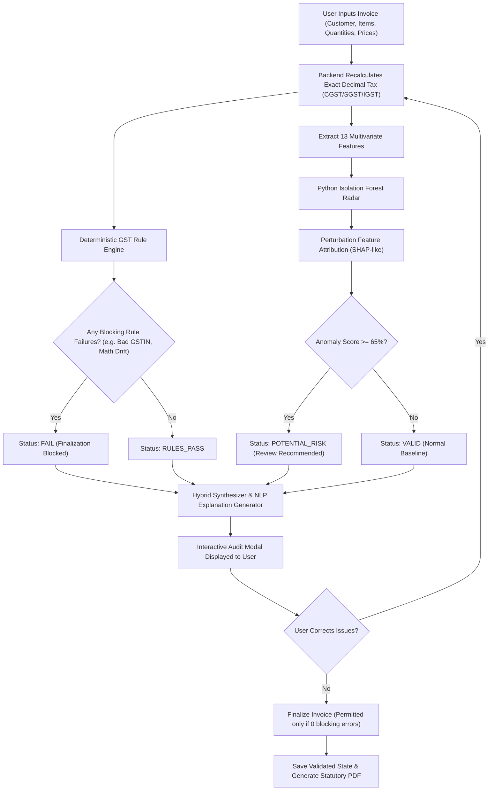

# GST SAHAYAK — System Architecture & Technical Design

**Project Title:** GST Sahayak – A Hybrid Rule-Based and Explainable-AI System for GST Invoice Pre-Validation and Anomaly Detection  
**Academic Degree:** Bachelor of Technology / Final Year Engineering Capstone Project  
**Tech Stack:** React 19 + TypeScript + Tailwind CSS | Node.js + Express + Prisma | Python 3 + Scikit-Learn Isolation Forest  

---

## 1. Architectural Philosophy: The Hybrid Triad

Most financial validation systems suffer from one of two extremes:
1. **Purely Rule-Based Systems:** They can check whether math adds up or if a GSTIN matches a regex, but they are completely blind to commercial anomalies (e.g., selling a laptop for ₹500 or billing 5,000 units to a retail consumer).
2. **Purely Machine-Learning Systems:** Neural networks or LLMs are non-deterministic and can hallucinate arithmetic, making them legally unsafe for statutory tax filing.

**GST Sahayak solves this through a Hybrid Triad Architecture:**

```
                  ┌────────────────────────────────────────────────────────┐
                  │                 CLIENT APPLICATION                     │
                  │   React 19 • TypeScript • Tailwind CSS • Framer Motion │
                  └──────────────────────────┬─────────────────────────────┘
                                             │ HTTP / REST / JSON
                                             ▼
                  ┌────────────────────────────────────────────────────────┐
                  │              EXPRESS.JS BACKEND ENGINE                 │
                  │         JWT Auth • Decimal Math • Prisma ORM           │
                  └────────────┬─────────────────────────────┬─────────────┘
                               │                             │
                ┌──────────────┴──────────────┐              │ Stdin / Stdout Subprocess
                ▼                             ▼              ▼
  ┌───────────────────────────┐ ┌──────────────────────────┐ ┌──────────────────────────┐
  │   DETERMINISTIC RULES     │ │     RELATIONAL DB        │ │   AI ANOMALY DETECTOR    │
  │  10+ Statutory GST Checks │ │  SQLite (dev.db)         │ │  Scikit-Learn Isolation  │
  │  (CGST Act Sec 31, R-138) │ │  Users, Invoices, Items  │ │  Forest + Perturbation   │
  │  Zero Hallucinations      │ │  22,600+ CBIC HSN Master │ │  SHAP Attributions       │
  └─────────────┬─────────────┘ └──────────────────────────┘ └────────────┬─────────────┘
                │                                                         │
                └─────────────────────────────┬───────────────────────────┘
                                              ▼
                               ┌─────────────────────────────┐
                               │     EXPLAINABLE AI (XAI)    │
                               │  Feature Contribution %     │
                               │  Actionable Verification    │
                               └─────────────────────────────┘
```

---

## 2. Core Validation Workflow Pipeline



---

## 3. Detailed Component Breakdown

### 3.1 Layer 1: Frontend Client
- **Framework:** React 19 single-page application built with Vite and TypeScript.
- **Styling & Interaction:** Tailwind CSS with custom cyber-glass styling, dark mode navy palette (`#07111F`), and hardware-accelerated transitions via Framer Motion.
- **State Management:** React Context API (`AuthContext`) managing persistent JWT authentication, active business profiles, and toast notifications.
- **Data Visualization:** Recharts rendering dynamic monthly turnover charts, risk distribution donuts, and anomaly telemetry bars.

### 3.2 Layer 2: Express.js Backend & Rule Engine
- **Runtime:** Node.js (v24 LTS) utilizing native ECMAScript Modules (`import/export`).
- **Middleware:** CORS, JSON parser, custom request logger, and `authMiddleware` enforcing Bearer token validation and multi-tenant scoping.
- **Rule Engine (`server/src/rules/gstRuleEngine.js`):** Pure deterministic function taking invoice payload, tenant profile, and historical sequence records, returning an immutable array of rule evaluations with expected vs actual values.

### 3.3 Layer 3: Python Machine Learning Subsystem
- **Engine:** `ai_engine/anomaly_detector.py` executing under Python 3.14.
- **Algorithm:** Isolation Forest (`sklearn.ensemble.IsolationForest`). Unlike supervised classification that requires fraudulent labels, Isolation Forest detects anomalies based on the fact that outliers are few and mathematically distant, requiring fewer tree splits to isolate in feature space.
- **Attribution Algorithm:** Baseline perturbation analysis. Each feature is sequentially replaced with its historical dataset mean, and the drop in anomaly score measures that feature's relative percentage contribution to the risk verdict.

### 3.4 Layer 4: Relational Data Persistence (Prisma ORM)
- **Database Engine:** SQLite in development (`server/prisma/dev.db`), architected for seamless migration to PostgreSQL in production via Prisma.
- **Key Relational Models:**
  - `User` 1:1 `Business`
  - `User` 1:N `Product`, `Customer`, `Invoice`, `AuditLog`
  - `Invoice` 1:N `InvoiceItem`, 1:N `ValidationResult`, 1:1 `AnomalyResult`
  - `HsnMaster` and `GstRateMaster` storing official CBIC tariff schedules.

---

## 4. Multi-Tenant Security Model

Each request lifecycle enforces tenant boundary validation:

```
[Incoming Request]
       │
       ▼
[authMiddleware]
  ├── Extracts JWT from 'Authorization: Bearer <token>'
  ├── Verifies signature using server secret
  ├── Loads User record from DB (fails if deleted/invalid)
  └── Attaches `req.user` to request object
       │
       ▼
[Protected Route Handler]
  ├── All database reads: `where: { userId: req.user.id }`
  ├── All database writes: `data: { userId: req.user.id, ... }`
  └── Cross-tenant updates blocked: `where: { id, userId: req.user.id }`
```

---

## 5. Summary of Viva & Presentation Points

1. **Why Hybrid?** Rules provide statutory legal certainty; Machine Learning catches commercial price and quantity outliers that rules cannot foresee.
2. **Why Isolation Forest?** GST tax fraud data is rare, imbalanced, and confidential. Unsupervised anomaly detection does not require labelled fraud datasets.
3. **What is Explainable AI here?** We explain *why* the model raised a flag using exact feature contribution weights (e.g., 42% due to unit price deviation), giving Chartered Accountants actionable verification steps.

