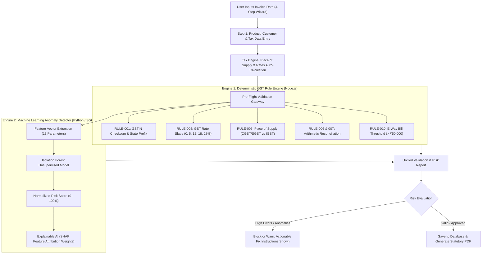

# 🇮🇳 GST Sahayak — Project Overview, Purpose (POP) & Benefits

> **“Smarter Invoices. Safer Business.”**  
> *A Hybrid Rule-Based and Explainable-AI System for Pre-Validation and Anomaly Detection in Indian GST Invoices.*

---

## 📑 Table of Contents
1. [Executive Summary & One-Line Pitch](#1-executive-summary--one-line-pitch)
2. [What is POP? (Purpose of Project / Problem, Objective, Proposal)](#2-what-is-pop-purpose-of-project)
3. [Why Are We Making This Application? (The Problem & Motivation)](#3-why-are-we-making-this-application)
   - [3.1 The Indian GST Landscape & Regulatory Pressure](#31-the-indian-gst-landscape--regulatory-pressure)
   - [3.2 The Flaw in Existing Billing & ERP Tools](#32-the-flaw-in-existing-billing--erp-tools)
   - [3.3 The Real-World Cost of Invoice Errors](#33-the-real-world-cost-of-invoice-errors)
4. [What Are the Benefits of This Project?](#4-what-are-the-benefits-of-this-project)
   - [4.1 Benefits for Business Owners & MSMEs](#41-benefits-for-business-owners--msmes)
   - [4.2 Benefits for Chartered Accountants (CAs) & Tax Practitioners](#42-benefits-for-chartered-accountants-cas--tax-practitioners)
   - [4.3 Financial & Statutory Benefits](#43-financial--statutory-benefits)
   - [4.4 Technological & Innovation Benefits](#44-technological--innovation-benefits)
5. [Core Objectives of GST Sahayak](#5-core-objectives-of-gst-sahayak)
6. [System Architecture & Hybrid Dual-Engine Strategy](#6-system-architecture--hybrid-dual-engine-strategy)
7. [Comprehensive Feature Breakdown](#7-comprehensive-feature-breakdown)
8. [Comparison: Traditional Software vs. GST Sahayak](#8-comparison-traditional-software-vs-gst-sahayak)
9. [Real-World Failure Cases Solved by GST Sahayak](#9-real-world-failure-cases-solved-by-gst-sahayak)
10. [Target Audience & Future Roadmap](#10-target-audience--future-roadmap)

---

## 1. Executive Summary & One-Line Pitch

**One-Line USP:**
> *"GST Sahayak combines deterministic statutory GST rule validation with Explainable AI (XAI) to intercept invoice non-compliance and statistical anomalies before finalization, protecting businesses from blocked Input Tax Credit (ITC) and costly tax penalties."*

Traditional accounting and ERP software (such as Tally, Busy, or standard Excel templates) are **passive recording tools**—they record whatever numbers the operator inputs without actively verifying statutory rules or detecting unusual transaction patterns. 

**GST Sahayak** transforms invoice generation from a passive bookkeeping task into an **active, intelligent compliance shield**.

---

## 2. What is POP? (Purpose of Project)

In software development and statutory systems, **POP** stands for:
- **Purpose of the Project**: Why this software exists and the mission it fulfills.
- **Problem, Objective & Proposal**:
  - **Problem:** Frequent invoice calculation errors, improper HSN/SAC classifications, place-of-supply mismatches, and delayed anomaly detection under Indian GST laws.
  - **Objective:** Provide real-time pre-validation, explainable anomaly scoring, and intelligent statutory guidance prior to invoice submission.
  - **Proposal:** A modern, full-stack web application combining a **10-Point Deterministic Rule Engine** with an **Unsupervised Machine Learning Model (Isolation Forest)** and **Explainable AI (SHAP-inspired feature attribution)**.

### The Purpose Statement:
> *The fundamental purpose of GST Sahayak is to eliminate human error, tax mismatches, and compliance friction from the Indian B2B and B2C invoicing lifecycle by validating every invoice at the point of origin, before it reaches the customer, the GST Portal, or an auditor.*

---

## 3. Why Are We Making This Application?

### 3.1 The Indian GST Landscape & Regulatory Pressure
The Goods and Services Tax (GST) system in India is one of the most automated and scrutinized indirect tax regimes in the world:
- Every B2B invoice must reconcile seamlessly across **GSTR-1** (Supplier’s outward supplies), **GSTR-2B** (Buyer’s auto-drafted ITC statement), and **GSTR-3B** (Summary return).
- If a supplier makes an error in **GSTIN**, **Place of Supply**, **HSN Code**, or **Tax Slab (0%, 5%, 12%, 18%, 28%)**, the buyer cannot claim **Input Tax Credit (ITC)**.
- Under Section 50 of the CGST Act, incorrect tax filings attract interest rates of **18% to 24% per annum**, plus strict penalties under Section 122.

### 3.2 The Flaw in Existing Billing & ERP Tools
1. **Garbage In, Garbage Out:** Legacy software like Tally or spreadsheets allows operators to enter an invalid GSTIN, wrong tax split (e.g. charging CGST+SGST on an inter-state sale), or mismatched line-item math. The software silently saves it.
2. **Post-Mortem Discovery:** Most errors are discovered 30 to 45 days later, at the end of the month or quarter, when the CA reconciles the books or when the client rejects the invoice due to missing GSTR-2B credit.
3. **Black-Box AI or No AI:** Traditional tools have zero capability to detect fraudulent discounts, extreme price outliers, or unusual invoice bursts. When AI tools do exist, they are "black boxes" that give a risk score with no explanation.
4. **Complex HSN/SAC Catalogs:** The Indian GST tariff contains over 10,000+ HSN and SAC codes. Accountants and business owners frequently guess or copy outdated codes, inviting departmental audits.

### 3.3 The Real-World Cost of Invoice Errors
| Error Type | What Happens in Legacy Tools | Real-World Consequence |
|---|---|---|
| **Inter-State Tax Mismatch** | Applies CGST + SGST instead of IGST | Tax paid under wrong head; buyer denied ITC; cash flow locked |
| **Typo in Grand Total** | Line items sum to ₹50,000, Total typed as ₹5,000 | Revenue loss or audit notice for under-reporting tax |
| **Missing E-Way Bill Flag** | Invoices > ₹50,000 generated without alert | Consignment intercepted at checkpost; goods detained, 200% penalty |
| **Invalid GSTIN Structure** | Malformed GSTIN saved without verification | Invoice cannot be uploaded to GSTN; client payment withheld |
| **Abnormal Discount / Price Outlier** | Typo: Unit price ₹10 instead of ₹1,000 | Direct financial loss, stock discrepancy, suspicion of tax evasion |

---

## 4. What Are the Benefits of This Project?

### 4.1 Benefits for Business Owners & MSMEs
- **Zero-Penalty Assurance:** Invoices are mathematically and legally validated before generation.
- **Unblocked Cash Flows:** Clients never withhold payments due to invoice format rejections or ITC claim failures.
- **AI HSN Assistant:** Business owners do not need to memorize tariff manuals; typing product descriptions (e.g., *"ASUS TUF A16"* or *"Cloud Consulting"*) provides instant HSN codes with confidence ratings.
- **Instant Statutory PDF Invoicing:** Generate professional, GST-compliant tax invoices with QR-ready layouts, HSN tables, and tax split columns in one click.
- **User-Friendly Guided Flow:** A 4-step wizard makes billing fast and accessible even for non-accountants.

### 4.2 Benefits for Chartered Accountants (CAs) & Tax Practitioners
- **80% Reduction in Reconciliation Headaches:** Invoices enter the accounting books clean and pre-screened.
- **Explainable Anomaly Alerts:** Instead of manually reviewing thousands of line items, CAs can review the **Risk Tier** and see exactly *why* an invoice was flagged (e.g. *"Discount is 3.8x above customer history"*).
- **Rule Engine Customizability:** CAs and administrators can toggle rules on/off or alter severity levels (Error, Warning, Info) based on changing company policies or tax notifications.
- **Audit Trails:** Complete system log showing user actions, validation outcomes, and timestamped changes.

### 4.3 Financial & Statutory Benefits
- **Protection of Input Tax Credit (ITC):** Guarantees that invoices meet all Section 16 requirements for buyer credit claims.
- **Automatic E-Way Bill Detection:** Alerts operators whenever consignment value exceeds the statutory threshold of **₹50,000**, preventing goods detention.
- **Accurate Place of Supply (POS) Logic:** Automatically enforces 50-50 CGST+SGST for Intra-State transactions and 100% IGST for Inter-State transactions.
- **Statutory Rate Guard:** Confirms that tax percentages match official GST Council slabs (0%, 5%, 12%, 18%, 28%).

### 4.4 Technological & Innovation Benefits
- **Hybrid Intelligence Architecture:** Combines deterministic boolean logic (guaranteed legal precision) with unsupervised machine learning (statistical risk discovery).
- **Isolation Forest ML Model:** Evaluates multivariate features (unit price deviations, category averages, discount spikes, transaction frequency) to catch unknown fraud or severe human typos.
- **Transparent Explainable AI (XAI):** Uses SHAP-inspired feature attribution so humans understand the exact contribution of each factor rather than trusting a blind score.
- **Modern Responsive Web Stack:** Built with React 18, TypeScript, Tailwind CSS, Node.js, Express, Prisma ORM, and Python Scikit-Learn.

---

## 5. Core Objectives of GST Sahayak

1. **Pre-Validation at Source:** Shift the validation paradigm from "post-filing reconciliation" to "real-time creation-stage screening".
2. **Dual-Layered Verification:**
   - Layer 1: Deterministic Compliance (10+ Statutory GST Rules).
   - Layer 2: Statistical Outlier & Anomaly Detection (Isolation Forest).
3. **Explainability Over Obscurity:** Ensure every warning or risk score is accompanied by human-readable root cause explanations and corrective actions.
4. **Democratization of Compliance:** Provide MSMEs with enterprise-level financial audit technology through an intuitive, accessible web application.
5. **Frictionless Workflow:** Seamless integration of business profiles, product master catalogs, intelligent tax auto-calculation, and PDF printing.

---

## 6. System Architecture & Hybrid Dual-Engine Strategy

---

## 7. Comprehensive Feature Breakdown

| Feature Module | Technical Implementation | Purpose & User Benefit |
|---|---|---|
| **User Authentication & Split Portal** | JWT, Bcrypt, One-Click Instant Demo Login | Secure user session management with zero setup friction for demo evaluations. |
| **KPI Telemetry Dashboard** | Recharts, Dynamic Aggregates | Real-time visibility into turnover, tax collected, total invoices, and risk distributions. |
| **Business Profile & Statutory Setup** | State Code regex, PAN checksum | Guarantees business credentials conform to GST rules before any invoices are issued. |
| **Product Master & AI HSN Assistant** | Semantic matching against HSN/SAC master database | Prevents wrong HSN usage; offers confidence scores and manual override options. |
| **4-Step Create Invoice Wizard** | React Hook Form, Dynamic Line-Items | Guided data entry minimizing cognitive load and preventing incomplete submissions. |
| **Deterministic Rule Engine** | 10 Configurable Rule Evaluators | Catches format errors, mathematical discrepancies, duplicate invoice numbers, and missing fields. |
| **Scikit-Learn Anomaly Detector** | Isolation Forest algorithm | Flags abnormal pricing, out-of-pattern discounts, and unusual transaction volumes. |
| **Explainable AI (XAI) Modal** | SHAP-inspired weight distribution | Explains the exact mathematical reasons behind flagged transactions. |
| **Invoice History & Search** | Full-text query, Risk Tier filters | Immediate access to historical invoices with one-click audit review and PDF re-print. |
| **Reports & Tax Schedules** | Aggregated CGST, SGST, IGST summaries | Generates filing-ready summaries compatible with monthly GSTR-1 and GSTR-3B filings. |
| **Admin Rule Management & Audits** | Dynamic rule toggles and severity controls | Allows administrators to customize business compliance thresholds without modifying code. |

---

## 8. Comparison: Traditional Software vs. GST Sahayak

| Feature / Capability | Traditional Accounting (Tally / Busy) | Basic Spreadsheets (Excel / Sheets) | GST Sahayak 🇮🇳 |
|---|---|---|---|
| **Invoice Pre-Validation** | ❌ Post-facto during filing | ❌ None | ✅ Real-time at point of creation |
| **GSTIN Format & State Check** | ⚠️ Partial / Basic | ❌ None | ✅ Rigorous regex & state prefix matching |
| **Place of Supply Tax Logic** | ⚠️ Requires manual tax head selection | ❌ Manual formula entry | ✅ Automatic detection (CGST+SGST vs IGST) |
| **Statutory GST Rate Enforcement** | ⚠️ Accepts any custom rate | ❌ No validation | ✅ Strict adherence to official Council slabs |
| **AI HSN/SAC Suggestion** | ❌ Manual search in tariff books | ❌ None | ✅ Automated AI matching with confidence score |
| **Machine Learning Outlier Detection** | ❌ None | ❌ None | ✅ Isolation Forest ML model |
| **Explainable AI Risk Attribution** | ❌ None | ❌ None | ✅ SHAP-style percentage feature explanations |
| **E-Way Bill Threshold Warning** | ⚠️ Optional add-on | ❌ None | ✅ Automatic flag when consignment > ₹50,000 |
| **Arithmetic Cross-Verification** | ⚠️ Limited | ⚠️ Prone to broken formulas | ✅ 100% automated line-item reconciliation |
| **Modern User Experience** | ❌ Legacy desktop UI (keyboard only) | ❌ Raw grid | ✅ Beautiful, responsive modern web interface |

---

## 9. Real-World Failure Cases Solved by GST Sahayak

### Scenario 1: The Intra-State vs. Inter-State Blunder
- **The Problem:** A supplier based in Maharashtra (State Code 27) sells goods to a buyer in Karnataka (State Code 29). The data entry operator accidentally charges 9% CGST + 9% SGST instead of 18% IGST.
- **In Traditional Tools:** The invoice is printed and sent. One month later, the buyer's CA rejects the invoice because Maharashtra CGST cannot be credited in Karnataka. The supplier must issue a credit note and re-issue the invoice, creating a 30-day cash flow delay.
- **In GST Sahayak:** `RULE-GST-005` immediately triggers an **ERROR**: *"Supplier is in Maharashtra (27) but Place of Supply is Karnataka (29). Inter-state supplies must charge IGST, not CGST/SGST."* The invoice cannot be finalized until corrected.

### Scenario 2: The Catastrophic Decimal Typo (Price Outlier)
- **The Problem:** An operator invoicing 100 units of industrial bearings (standard unit price ₹5,000) accidentally enters the price as ₹50,000 per unit (a 10x typo) or offers a 95% discount instead of 5%.
- **In Traditional Tools:** The mathematical total is calculated correctly on paper, so the system allows it. The invoice is generated and processed.
- **In GST Sahayak:** The **Isolation Forest Machine Learning Engine** flags the invoice with a **🔴 High Anomaly Risk Score (89%)**. The Explainable AI module highlights: *"Unit price is 900% above category average (Contribution: +44%) and discount rate deviates significantly from customer history (Contribution: +31%)."* The operator is prompted to review before saving.

### Scenario 3: E-Way Bill Oversight
- **The Problem:** A consignment worth ₹68,000 is dispatched without an E-Way Bill because the operator was unaware of the threshold.
- **In Traditional Tools:** The bill is generated without any notification. The delivery truck is intercepted at a state border, resulting in goods impoundment and a penalty of up to 200% of the tax amount.
- **In GST Sahayak:** `RULE-GST-010` flags an immediate **WARNING**: *"Total invoice value exceeds statutory limit of ₹50,000. An E-Way Bill is mandatory for transporting this consignment."*

---

## 10. Target Audience & Future Roadmap

### Target Audience
1. **Micro, Small & Medium Enterprises (MSMEs):** Businesses looking for simple, error-free invoicing without paying for expensive, complex enterprise ERP software.
2. **Chartered Accountants (CAs) & Tax Consultants:** Firms managing GST returns for multiple clients who need clean, pre-validated billing data to streamline GSTR-1 and GSTR-3B filings.
3. **E-Commerce & Retail Vendors:** Sellers handling multi-state orders who need automated Place of Supply and tax rate assurance.
4. **Corporate Finance & Internal Audit Teams:** Organizations seeking proactive fraud prevention and statistical anomaly detection on high-volume accounts receivable/payable.

### Future Roadmap
- 🔗 **Direct GSTN & E-Invoice API Integration:** Direct one-click generation of IRN (Invoice Reference Number) and QR codes via government E-Invoicing portals (NIC/IRP).
- 📷 **AI Document OCR for Vendor Invoices:** Optical Character Recognition to scan physical or PDF vendor bills and run the same pre-validation engine before booking input credit.
- 🔄 **Two-Way ERP Sync (Tally / Zoho / SAP):** Headless API integration allowing businesses to use GST Sahayak as a verification middleware before invoices are written into core ERP ledgers.
- 📱 **Mobile Application:** On-the-go billing and invoice status tracking for warehouse managers and field sales representatives.

---

> **Prepared for:** GST Sahayak Project Evaluation, Academic Submissions, Stakeholder Briefings & Client Presentations.  
> **Repository:** [BLEACH321/Gst-pro](https://github.com/BLEACH321/Gst-pro)  
> **Author & Lead Developer:** Sunny Gupta (`sunny@gstpro.com`)
